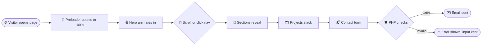

<!-- ========================= ANIMATED HEADER ========================= -->
<div align="center">


<br/>


<br/><br/>

<a href="#-about"></a>
<a href="#-features"></a>
<a href="#-quick-start"></a>
<a href="#-customize-it"></a>
<a href="#-contact"></a>

</div>


## 👋 About


This is the personal portfolio of **Nida Ali**, an AI engineer and Python developer specializing in **AI automation, LLM integration, custom chatbots, multi-agent systems, computer vision and NLP**.

The whole site lives in **one `index.php` file**: no frameworks, no build step, no npm. Drop it on any PHP host and it runs. Every section is driven by PHP data arrays, so updating content means editing a list, not hunting through HTML.


## ✨ Features

<div align="center">

</div>

<table>
<tr>
<td width="50%" valign="top">

### 🎬 Motion
- 🔢 Counting **preloader** with a curtain-wipe reveal
- 🌈 Name **flips in letter by letter** with a flowing gradient
- ⌨️ **Typing effect** cycling through roles
- ⚛️ **3D atom rings** around a breathing, glowing core
- 📝 Headings that **slide up word by word**
- 🔐 Section labels that **decode** like a cipher
- 🗂️ **Sticky stacking** project cards that shrink and dim
- 🎞️ Two **marquee rows** that speed up and tilt with scroll speed
- 📍 Scroll-drawn **timeline** with a travelling glow

</td>
<td width="50%" valign="top">

### 🖱️ Interaction
- 🎯 **Custom cursor** that morphs into an "Explore" bubble
- 💥 **Click sparks** in the brand colours
- 🧲 **3D tilt** cards and **magnetic** buttons
- 🔦 Mouse-following **spotlight** and rotating **glow borders**
- 🕸️ **Particle network** that reaches for the mouse
- 🌌 **Parallax** hero visual
- 💊 Sliding **active-section pill** in the navbar
- 🔘 Side **dot navigation** and a **progress-ring** back-to-top button
- 🙈 Navbar hides on scroll down, returns on scroll up

</td>
</tr>
<tr>
<td width="50%" valign="top">

### ⚙️ Under the Hood
- 📄 **Single file**: PHP, CSS and JS together
- 🗃️ **Content in PHP arrays**, rendered with loops
- 🛡️ All output escaped with `htmlspecialchars`
- 🧭 **Smooth-scroll navigation** with an offset for the fixed navbar
- 🚄 Scroll work batched with `requestAnimationFrame`
- 👀 Content stays visible if JavaScript is off

</td>
<td width="50%" valign="top">

### 📬 Contact Form
- ✉️ Sends email with PHP `mail()`
- 🔑 **CSRF token** check
- 🍯 **Honeypot** field against bots
- ✅ Server-side validation
- 💾 Keeps typed values on error
- 🎉 Animated success and error messages

</td>
</tr>
</table>


## 🧭 Sections

| # | Section | What it shows |
|:-:|---|---|
| 🏠 | **Hero** | Name, rotating roles, intro, call-to-action buttons, animated orbit visual |
| 01 | **About** | Professional summary, email, LinkedIn, location, animated counters |
| 02 | **Skills** | AI & LLMs · Automation · Computer Vision · NLP · Programming · Web & APIs |
| 03 | **Experience** | Pro Codes Solutions · Freelance · Proit, on an animated timeline |
| 04 | **Projects** | PrecisionPen · Gesture-Controlled Image Resizing · Text Preprocessing Pipeline |
| 05 | **Education** | Master of Computer Applications (FAST-NUCES) · BS Computer Science (Qarshi University) · Languages |
| 06 | **Contact** | Contact details and the working PHP form |

### How a visit flows




## 🛠️ Tech Stack

<div align="center">


</div>

| Layer | Used for |
|---|---|
| 🐘 **PHP** | Content data, rendering loops, contact form, CSRF and validation |
| 🧱 **HTML5** | Semantic page structure |
| 🎨 **CSS3** | Keyframes, 3D transforms, `@property` animated gradients, glassmorphism, responsive grid |
| ⚡ **Vanilla JS** | Smooth scroll, IntersectionObserver reveals, canvas particles, cursor, tilt, marquee |
| 🔤 **Google Fonts** | Space Grotesk · Inter · JetBrains Mono |


## 🚀 Quick Start


**Option 1 · PHP built-in server**
```bash
git clone https://github.com/your-username/your-repo.git
cd your-repo
php -S localhost:8000
```
Open **http://localhost:8000**

**Option 2 · XAMPP / WAMP / MAMP**
1. Copy `index.php` into `htdocs` (or `www`)
2. Start Apache
3. Open **http://localhost/index.php**

**Option 3 · Shared hosting**
Upload `index.php` to `public_html`. Done. 🎉

> **Requirements:** PHP 7.4+. No database, no Composer, no Node.


## 🎨 Customize It

<details>
<summary><b>📝 Edit the content</b></summary>
<br/>

All content sits in arrays at the **top of `index.php`**:

```php
$profile    = [ 'name' => ..., 'title' => ..., 'email' => ..., 'linkedin' => ..., 'summary' => ... ];
$roles      = [ 'AI Engineer', 'Python Developer', ... ];   // typing effect
$stats      = [ ... ];                                      // About counters
$skills     = [ ... ];                                      // skill cards
$experience = [ ... ];                                      // timeline
$projects   = [ ... ];                                      // project cards
$education  = [ ... ];
$languages  = [ 'English', 'Urdu', 'Arabic', 'Turkish' ];
```
</details>

<details>
<summary><b>➕ Add a project</b></summary>
<br/>

```php
[
    'num'    => '04',
    'title'  => 'My New Project',
    'sub'    => 'Short tagline',
    'stack'  => ['Python', 'FastAPI'],
    'points' => ['What it does', 'What makes it interesting'],
    'grad'   => 'g1', // g1, g2 or g3 background
],
```
</details>

<details>
<summary><b>🌈 Change the colours</b></summary>
<br/>

```css
:root{
  --c1:#7c5cff;  /* violet */
  --c2:#00e0ff;  /* cyan   */
  --c3:#ff4fd8;  /* pink   */
  --c4:#38f9a6;  /* mint   */
}
```
</details>

<details>
<summary><b>📬 Contact form setup</b></summary>
<br/>

The form sends messages to `$profile['email']` using PHP's `mail()`.

| Where you run it | Email works? |
|---|:-:|
| Shared hosting (cPanel, Hostinger, etc.) | ✅ usually |
| Local XAMPP / `php -S` | ❌ no mail server |
| VPS | ⚙️ needs mail / SMTP setup |

If your host blocks `mail()`, swap that one call for [PHPMailer](https://github.com/PHPMailer/PHPMailer) with SMTP.
</details>


## ♿ Accessibility & Performance

- 🧘 Honours **`prefers-reduced-motion`**: animations switch off for people who ask for less motion
- 🖱️ Cursor and tilt effects only run on devices with a mouse
- 👀 Readable with JavaScript disabled
- 📱 Fewer particles on small screens, mobile menu below 980px

## 📁 Structure

```
📦 portfolio
 ┣ 📜 index.php    ← the entire website
 ┗ 📜 README.md
```


## 📬 Contact

<div align="center">


<a href="mailto:nidaali.contact@gmail.com"></a>
<a href="https://linkedin.com/in/nida-ali-1b6659447"></a>


<br/><br/>

⭐ **If you like this portfolio, give the repo a star!** ⭐


</div>
